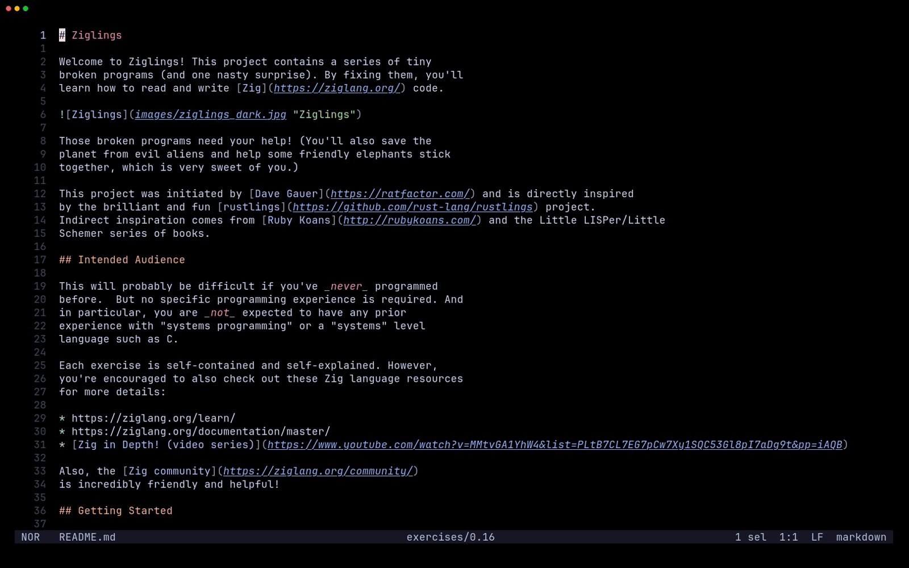

# who.hx

who.hx shows inline git blame for [Helix](https://github.com/helix-editor/helix/).

See who last touched the current line, right where your cursor is, without leaving the buffer.



---

## Installation

**1. Install the plugin-enabled fork of Helix** by following the instructions [here](https://github.com/mattwparas/helix/blob/steel-event-system/STEEL.md).

**2. Install who.hx via forge:**

```sh
forge pkg install --git https://github.com/Ra77a3l3-jar/who.hx.git
```

**3. Load the plugin** by adding this to your `init.scm`:

```scheme
(require "who/who.scm")
```

---

## Usage

| Command | Action |
|---|---|
| `:who-toggle` | Enable/disable the blame hint |
